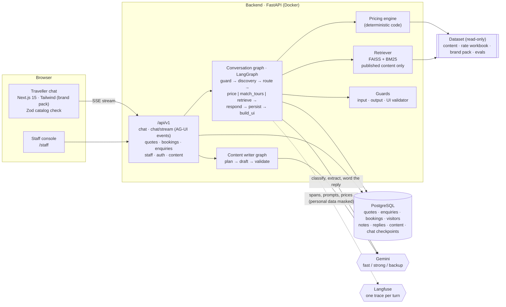
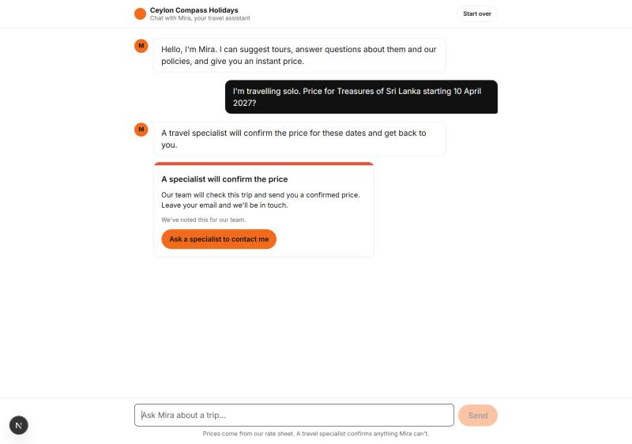
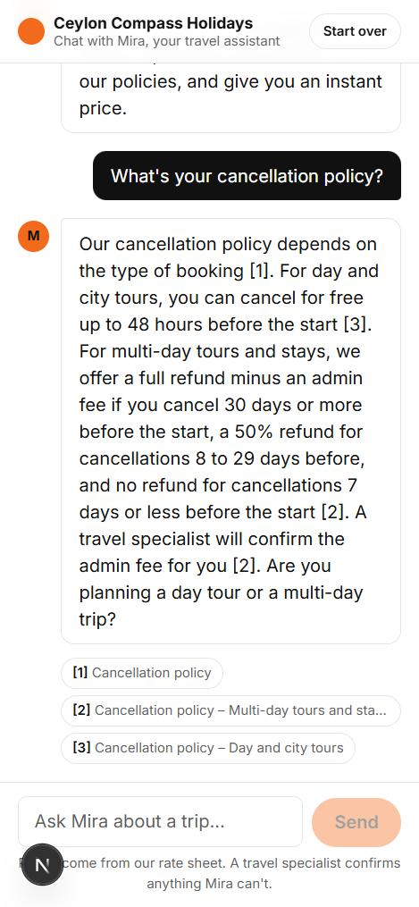
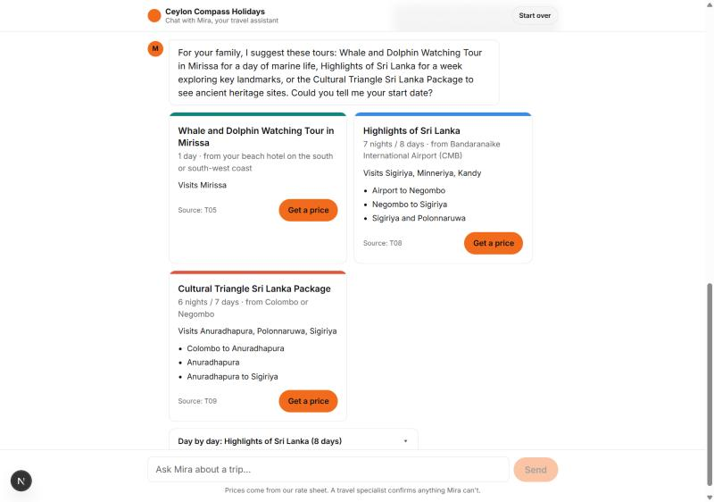

# Mira – AI Travel Booking Assistant

Conversational booking assistant for **Ceylon Compass Holidays**, a fictional Sri Lankan tour operator. A traveller chats with **Mira**. Mira works out the trip and who is travelling, shows real tours, itineraries and photos, quotes prices that come only from the rate workbook through code, takes a mock booking, and saves every quote as a private enquiry for the sales team. Staff work in a separate console: enquiries, notes, replies to travellers, and AI-drafted tours that only an approver can publish.

**Contents:** [What it does](#what-it-does) · [Quick start](#quick-start) · [Architecture](#architecture) · [Design decisions and trade-offs](#design-decisions-and-trade-offs) · [Evaluation](#evaluation) · [Known limitations](#known-limitations) · [AI tools used](#ai-tools-used) · [Reference](#reference)

## What it does

| # | Requirement | How Mira does it |
|---|---|---|
| 1 | Discover the trip (≤ 3 questions) | One LLM call per turn extracts the trip details; **code** decides what is still missing and asks one combined question at a time, at most 3 per conversation, before showing tours or a price. Trip type and traveller type are derived by code. |
| 2 | Remember returning visitors | An anonymous visitor ID keeps the party, interests and last quote (no names or contact details). A new chat starts from what is known, and "welcome back" re-prices the last quote with today's rates. |
| 3 | Generate the interface | Code picks components from a fixed catalog of 9. Every payload is validated on the server (Pydantic) and again in the browser (Zod). Styled from the dataset's brand pack; works at 375 px and on desktop. |
| 4 | Answer from content only | Hybrid retrieval (Gemini embeddings + BM25) over published content only. Answers cite their sources, which are shown as chips. If the content doesn't answer it, Mira says so and offers the team. |
| 5 | Quote correct prices | A deterministic pricing engine reads the rate workbook (seasons, group size, child and single supplements, margin, deposit). The LLM never does arithmetic. Each quote stores cost, price and GP% for staff; travellers see only price and deposit. |
| 6 | Missing or expired rates | The engine refuses instead of guessing. Mira says a specialist will confirm, and the enquiry is flagged for staff with the reason. |
| 7 | Private enquiries | Every quote is saved as an enquiry. The staff console lists them (flagged first) with notes, a follow-up status, and replies to the traveller. |
| 8 | Approve AI-written content | Staff type a command ("Add a 5-day Hill Country tour using the Ella photos"); a second agent graph writes a draft. Only an Approver can publish (checked in code and by a database constraint); once published, Mira can answer about it. |
| – | Mock booking and payment | A mock card payment re-checks the price first. A failure shows a friendly message and a way forward, and saves an enquiry; never an error page. |

## Quick start

You need **Docker Desktop** (engine running), and the supplied dataset folder `ceylon-compass-dataset` **next to this repo** (`../ceylon-compass-dataset`; or set `MIRA_DATASET_HOST_DIR`). The dataset is mounted **read-only** and is never changed. You don't need Python or Node on your machine.

**1. Environment file.** Copy the example and fill in `GEMINI_API_KEY` (Google AI Studio). The Langfuse keys are optional (tracing). `.env` is git-ignored; never commit it.

```powershell
Copy-Item .env.example .env
```

(macOS/Linux: `cp .env.example .env`)

**2. Start everything** (PostgreSQL, the API and the website) with one command:

```powershell
docker compose up -d --build
```

| What | Address |
|---|---|
| Traveller chat | <http://localhost:3010> |
| Staff console | <http://localhost:3010/staff> (sign in with the demo accounts set in `.env`) |
| API and its docs | <http://localhost:8000/api/v1>, <http://localhost:8000/docs> |
| Health check | <http://localhost:8000/api/v1/health> |

After editing `.env`, restart the backend: `docker compose up -d backend`.

**Frontend with live reload (optional, for development):** `cd frontend`, `npm install`, `npm run dev`. It uses the same port, 3010, so stop the `frontend` container first.

**Check it works.** <http://localhost:8000/api/v1/health> should show:

| Field | Expected | Meaning |
|---|---|---|
| `status` | `ok` | The API is up |
| `today` | `2026-11-19` | The date used for quoting (`MIRA_TODAY`, configurable) |
| `dataset_found` / `dataset_integrity` | `true` / `ok` | The dataset is mounted and unchanged |
| `database` | `ok` | PostgreSQL answers |
| `index` | `ok (N chunks)` | The search index is built |
| `tracing` | `enabled` / `disabled` | Langfuse keys set or not |
| `llm_configured` / `llm_provider` | `true` / `gemini` | The chat model and its key |

**Tests:**

```powershell
docker compose exec backend python -m pytest
```

This runs about 920 unit, API and database tests, including the pricing engine's tests against the workbook's sample quotes. Tests that call Gemini are marked `live` and skipped by default (`python -m pytest -m live`).

## Architecture



**One traveller turn**, step by step (`backend/app/graph/`):


| Node | Who decides | What it does |
|---|---|---|
| `guard` | code + LLM | Input guard (injection patterns, personal data masked, discount and cost requests flagged), then **one** Gemini call that classifies the turn and extracts trip details |
| `discovery` | code | Merges the trip details into the shared typed state (`MiraState`); matches tour names to published tours only |
| `route` | code | Chooses the next step: ask (≤ 3 questions), price, suggest tours, retrieve, decline, hand off |
| `price` | code | Calls the pricing engine; a refusal (missing or expired rate, too many travellers) becomes a "specialist will confirm" with a reason flag |
| `match_tours` | code | Ranks the closest published tours for planners and custom requests |
| `retrieve` | code | Hybrid search over published content; abstains when nothing fits |
| `respond` | LLM, checked by code | Words the reply from the verified facts and sources only (fixed wording when no LLM is needed) |
| `persist` | code | Saves the quote (public and staff fields, trace ID) and its private enquiry, with flags |
| `build_ui` | code | Output guard on the text (no amount that isn't a verified quote), then picks and validates UI components |

The conversation state is kept per chat by a Postgres checkpointer, so Mira remembers the current chat after a reload or a restart. "New chat" starts a fresh thread.

## Design decisions and trade-offs

- **Code decides; the LLM reads and writes.** Gemini classifies the message, extracts trip details and words the reply. Routing, pricing, tour matching, permissions, publishing and UI selection are plain Python. *Trade-off:* less flexible conversation, but prices, flags and permissions are testable and can't be talked around.
- **Prices never pass through the LLM.** The pricing engine returns the quote; the reply repeats its numbers from fixed wording, and the output guard removes any amount that isn't in a verified quote. Price components carry only a `quote_id`; the browser fetches the public quote. *Trade-off:* the price wording is fixed rather than natural.
- **Refuse instead of guess.** Missing hotel rates, expired rate periods, stale tour pages and unpriced services make the engine refuse with a reason code. Mira hands off and the enquiry is flagged. *Trade-off:* some trips can't be quoted instantly.
- **One LLM call to read a turn.** Routing and extraction are one structured call, which halves the Gemini calls and quota use. The reply is a second call only when wording is needed; greetings, quotes and refusals use fixed wording.
- **Three Gemini models with fallback.** A fast model reads turns, a strong model writes answers, and a backup takes over on overload, timeout or quota. If all fail, rule-based reading and fixed wording keep the chat working. *Trade-off:* fallback replies are plainer.
- **Hybrid retrieval over published content only.** Embeddings plus BM25 catch both meaning and exact names. Drafts, rejected items and stale pages never reach the retriever; guest reviews are marked as opinion. *Trade-off:* an in-memory FAISS index, fine for this content size.
- **Generative UI chosen by code from a fixed catalog.** The catalog is one JSON Schema exported from Pydantic, checked by Zod in the browser and by a drift test. *Trade-off:* the LLM can't invent new layouts.
- **AG-UI-style SSE instead of CopilotKit.** `POST /chat/stream` sends AG-UI event types (`RUN_STARTED`, `STEP_FINISHED`, `TEXT_MESSAGE_*`, `CUSTOM ui_component`, `RUN_FINISHED`) over Server-Sent Events, read with `fetch`. CopilotKit would need its own Node runtime and a LangGraph state adapter. *Trade-off:* no CopilotKit features; the text arrives as one block because it is checked before it is shown.
- **Separation of duties for content.** Staff can draft; only an Approver can publish. This is enforced by `require_role()` and a database constraint (`published_needs_approver`), not by a prompt.
- **Privacy by design.** Contact details and card numbers go straight from forms to `/enquiries` and `/bookings`, never through the chat, the LLM or the traces. Emails, phones and card-like numbers are masked before the model or Langfuse sees a message. Only the card type and last four digits are kept.
- **The dataset stays as supplied.** It is mounted read-only and checked by hash. Its 30 data issues (text prices, missing rates, an inconsistent tour ID, a draft tour, an older duplicate page) are handled in loader code and listed in [docs/data-issues.md](docs/data-issues.md); see also [docs/data-notes.md](docs/data-notes.md).
- **Specialist replies stay out of the AI.** A specialist's reply is shown to the traveller exactly as written, in the same chat, with a mock email link. It never enters the graph state, so the LLM never rewrites it.

## Evaluation

The suite is the **17 starter cases** (read from the dataset, unchanged) plus **43 of our own** (`evaluation/test_cases/custom.jsonl`), 60 in total, including multi-turn conversations, off-topic questions and prompt-injection attempts. One command runs every case through the real graph and Gemini, each in a fresh conversation, with `MIRA_TODAY=2026-11-19`:

```powershell
docker compose exec -w / backend python -m evaluation.runner
```

Add `--case S02` (repeatable), `--category pricing` or `--requirement R6` to run fewer cases, and `--no-judge` to use code checks only.

**Code checks** (`evaluation/assertions.py`), wherever there is an exact answer:
- the exact price and deposit, re-checked against the pricing engine;
- no currency amount that isn't in a verified quote;
- no price, and a saved staff flag, when a rate is missing or expired;
- valid UI payloads;
- no draft or unpublished documents retrieved;
- the expected sources cited;
- no cost, margin or GP% shown;
- at most 3 questions.

**LLM judge** (`evaluation/judge.py`). It grades answer wording against each case's behaviour rule; code checks decide prices, flags and leaks. It is calibrated against 10 hand-labelled answers in `evaluation/test_cases/human_labels.jsonl`:

```powershell
docker compose exec -w / backend python -m evaluation.judge --calibrate
```

**Report:** [evaluation/reports/evaluation_report.md](evaluation/reports/evaluation_report.md). It shows targets vs actual, the pass rate per requirement and per check, judge agreement, dataset integrity, and every failing case with its replies and Langfuse trace links. The first run is kept as [baseline_2026-11-24.md](evaluation/reports/baseline_2026-11-24.md).

## Known limitations

- **Gemini availability.** On the free tier, Gemini is sometimes overloaded or out of quota. Mira then reads the turn with rules and replies with fixed wording, which is correct but plainer. A turn takes about 5 seconds on average, longer when models fall back.
- **No CopilotKit or A2UI.** Generative UI uses AG-UI event types over SSE, with our own client (see the trade-off above). The reply text is not streamed word by word.
- **Booking, payment and email are mocks.** No money moves, and the specialist's email is recorded, not sent.
- **Specialist replies are not pushed live.** The chat checks for new replies when the traveller comes back to the tab or reloads; there is no websocket.
- **Duplicate enquiries.** A chat that is auto-flagged and then sends the contact form creates two enquiries for staff.
- **A restored "Ask a specialist" card** shows its button again after a reload, even if the form was already sent.
- **Tour matching is word-based.** A tour named in unusual words may not match, and Mira then suggests close tours instead of pricing at once.
- **Retrieval is English only**, with an in-memory index rebuilt when the content changes.
- **Model routing is by task, not by complexity.** Reading a turn uses the fast model and writing an answer the strong one; there is no separate route for complex itineraries.
- **Local model (Ollama) is optional and slow.** On small GPUs a local model often misses the time budget, so Gemini is the default.
- **The judge is an LLM.** Its verdicts can vary between runs, which is why prices, flags and leaks are decided by code checks only.

## AI tools used

- **Claude Code (Anthropic, Claude models)** was used as an AI coding assistant throughout: planning, writing and refactoring code and tests, debugging with the evaluation suite and traces, and drafting documentation. Every change was reviewed, run and tested in this repo, and I can explain and change any part of it.
- **Gemini (Google)** is the runtime LLM inside Mira (turn reading, answer wording, content drafts, the LLM judge) and provides the search embeddings.
- **Not written by me:** the open-source libraries in `backend/requirements.txt` and `frontend/package.json`, and the photos in `backend/media/` (Wikimedia Commons, credited under each image with their licences). The dataset is the one supplied with the brief.

## Reference

### Configuration

All settings are environment variables; see `.env.example` for the full list. The important ones:

- `MIRA_TODAY`: "today" for quotes and date checks. Defaults to `2026-11-19`, the date the evaluation cases assume.
- `LLM_PROVIDER`: which model runs the chat: `gemini`, `deepseek`, `ollama`, or `auto` (DeepSeek if `DEEPSEEK_API_KEY` is set, otherwise Gemini). Search embeddings always use Gemini, so `GEMINI_API_KEY` is always needed.
- `GEMINI_MODEL_FAST` / `GEMINI_MODEL_STRONG` / `GEMINI_MODEL_BACKUP`: the three Gemini models (defaults `gemini-3.1-flash-lite`, `gemini-3.5-flash`, `gemini-3.5-flash-lite`).
  - **Order:** the requested model, then the backup, then the other main model.
  - **Overloaded:** retry the same model once, then switch. **Timeout or quota:** switch at once.
  - **Timeouts:** 10 s per call (15 s for the strong model), within a 25 s turn budget. A failing model is skipped for 30–60 s.
  - **Everything down:** Mira still replies with rule-based reading and fixed wording.
- `DEEPSEEK_API_KEY`: optional DeepSeek chat (`deepseek-chat`, function calling for structured output, longer timeouts).
- `OLLAMA_BASE_URL`: optional local model through Ollama (`qwen3:4b` by default), reached at `host.docker.internal:11434`.
- `MIRA_MARGIN_DAY` / `MIRA_MARGIN_MULTIDAY`: optional margin overrides; if empty, the rate workbook's values are used.
- `MIRA_STAFF_EMAIL` / `MIRA_STAFF_PASSWORD` and `MIRA_APPROVER_EMAIL` / `MIRA_APPROVER_PASSWORD`: the two demo staff accounts, created at startup only if a password is set, stored hashed.
- `LANGFUSE_PUBLIC_KEY` / `LANGFUSE_SECRET_KEY` / `LANGFUSE_HOST` / `LANGFUSE_PROJECT_ID`: optional tracing.

### Project layout

```
backend/            FastAPI app (Python 3.12, pip), runs in Docker
  app/main.py       entry point: app, CORS, routers
  app/api/          HTTP routes (/api/v1/...)
  app/core/         settings (all configuration comes from env / .env)
  app/data_loader/  reads the dataset (read-only) and logs its data issues
  app/pricing/      deterministic pricing engine: calculate_quote(), CLI python -m app.pricing
  app/booking/      mock payment provider and booking flow
  app/db/           tables, sessions, seed, repo (only what Mira creates is stored)
  app/rag/          content retrieval: chunker, Gemini embeddings, FAISS + BM25, retriever
  app/llm/          chat clients (Gemini, DeepSeek, Ollama), structured output, turn analysis
  app/guards/       input, output and UI guards (injection, personal data, invented prices)
  app/graph/        LangGraph workflows: conversation graph, content writer, prompts, tracing, CLI
  app/ui/           component catalog, component choice, photos
  app/visitors.py   returning visitors (R2)
  app/specialist.py specialist replies and the mock email
  media/            photos by place (Wikimedia Commons, with credits)
  tests/            unit/, api/, db/, rag/ and live/ tests
evaluation/         runner, code checks, LLM judge, cases and reports
frontend/           Next.js 15 + TypeScript + Tailwind v4 (port 3010)
  scripts/sync-brand.mjs     brand tokens generated from the dataset's brand_pack.json (npm run brand)
  scripts/check-catalog.mjs  checks the Zod catalog against the backend's JSON Schema (npm run check:catalog)
  src/lib/          brand tokens, API client, Zod catalog and its JSON Schema
  src/components/   Header, chat/ (Chat, Messages, Composer, TripPanel), catalog/ (generative UI)
  src/app/staff/    staff console: enquiries, enquiry detail, content drafts
docs/               data issues, dataset notes, screenshots
docker-compose.yml  db (PostgreSQL 16) + backend + frontend
.env.example        every setting, with placeholders only
```

### Database

Tables are created at startup if missing: visitors, conversations, quotes, enquiries, bookings, users, staff_sessions, enquiry_notes, specialist_replies, content_items and media, plus the LangGraph checkpoint tables for chat memory. Demo users and media are seeded. Both steps are safe to repeat. Tours, content and rates are never stored in the database: they are read from the dataset. Notes and specialist replies are append-only (a trigger refuses UPDATE and DELETE).

### API

All routes are under `/api/v1`; try them at <http://localhost:8000/docs>.

| Route | What it does |
|---|---|
| `POST /chat` | One traveller turn: `{message, conversation_id?, visitor_id?}` → reply, UI components, sources, `quote_id`. Send the `conversation_id` back to continue. |
| `POST /chat/stream` | The same turn as an AG-UI-style event stream (Server-Sent Events), used by the chat UI |
| `GET /conversations/{id}` | The messages so far, with each reply's components and any specialist replies |
| `GET /visitors/{id}/welcome` | "Welcome back" for a returning visitor, with the last quote re-priced today |
| `GET /quotes/{id}` | A saved quote, public fields only (never cost or margin) |
| `POST /quotes` | A direct quote from a form, through the same pricing engine |
| `POST /enquiries` | "Send to the team" with optional contact details |
| `GET /tours/{id}` | A published tour (drafts are 404); prices in the text are masked |
| `POST /bookings` | Mock booking: re-checks the price, then charges the deposit with the mock provider |
| `GET /health` | Status of the dataset, database, index, tracing and LLM |
| `POST /auth/login`, `POST /auth/logout`, `GET /auth/me` | Staff sign-in with a session cookie |
| `GET /staff/enquiries` | Staff: enquiries, flagged first; filter by `status` or `flagged` |
| `GET /staff/enquiries/{id}` | Staff: party, tour, price, deposit, **cost, GP%**, cost lines, flags, trace link, chat, notes, replies |
| `POST /staff/enquiries/{id}/notes` | Staff: add a note (notes can never be edited or deleted) |
| `POST /staff/enquiries/{id}/replies` | Staff: reply to the traveller in their chat, exactly as written, with a mock email |
| `PATCH /staff/enquiries/{id}/status` | Staff: `new`, `contacted`, `pending`, `confirmed` or `closed` (each change is noted) |
| `POST /staff/content`, `GET /staff/content`, `GET /staff/content/{id}` | Staff: draft a tour from a command, list and read drafts |
| `POST /staff/content/{id}/publish`, `POST /staff/content/{id}/reject` | **Approver only**: publish or reject a draft |

Every quote is saved with its public and staff fields and the Langfuse `trace_id`, plus a private enquiry for staff (`no_price` with reason flags when a specialist must confirm).

**Mock payments.** `4242 4242 4242 4242` succeeds and `4000 0000 0000 0002` is declined (Mastercard `5555 5555 5555 4444` and Amex `3782 822463 10005` also work). `MOCK_PAYMENT_FAIL=1` makes every charge fail. A failure returns a friendly message with next steps and saves a `booking_failed` enquiry. Card numbers are never stored or logged.

**Errors** always look like `{"error": "not_found", "message": "..."}`, with no stack traces. Logs mask emails, phone numbers and card numbers.

### Staff console

<http://localhost:3010/staff>. Sign in with a demo account from `.env`.

- **Sessions.** A random token in an HttpOnly, SameSite=Lax cookie that lasts 8 hours (`MIRA_SESSION_HOURS`). The database stores only its SHA-256; signing out deletes it. Set `MIRA_COOKIE_SECURE=1` over HTTPS.
- **Sign-in protection.** A wrong password and an unknown email get the same answer and take the same time. After 5 failures in 15 minutes, sign-in is refused for a while.
- **Roles.** Checked in code by `require_role()`: no session gets 401, the wrong role gets 403. Approvers can do everything staff can, plus publish.
- **Private data.** Cost, margin, GP% and contact details appear only in `/staff` responses; tests check every other route.
- **Trace links.** Each enquiry links to the Langfuse trace of the turn that produced its quote.

### Tracing

With the Langfuse keys set, each traveller turn is **one trace**, grouped by conversation as a session. It holds a span for every graph node and every Gemini call, the prompt version, the retrieved content and the price calculation. Emails, phone numbers and card-like numbers are masked before anything is sent to Langfuse. If Langfuse is unreachable, chat keeps working without traces.

Chat in the terminal, with the state of each turn: `docker compose exec backend python -m app.graph.cli --debug`.

### Generative UI

The catalog (`backend/app/ui/catalog.py`) has nine components: `traveller_picker`, `tour_card`, `itinerary_day`, `price_breakdown`, `booking_form`, `specialist_notice`, `source_list`, `photo_gallery` and `welcome_back`.

- **Code chooses, not the LLM.** `build_ui` picks components from the verified state (`app/ui/build.py`): a saved quote gives a tour card, a price card and a booking form; a refusal or an unanswered question gives a specialist notice; suggested tours give tour cards plus the top tour's day-by-day plan; a missing party gives the traveller picker.
- **Prices never travel in a component.** `price_breakdown` and `booking_form` carry only a `quote_id`.
- **Validated twice.** On the server against a Pydantic discriminated union with `extra="forbid"` (`app/guards/ui_validator.py`), which drops unknown types, extra props, markup, money amounts in text, and price components that don't point at this turn's quote; drops are recorded in the trace. In the browser again with Zod; each component has an error boundary.
- **One contract.** `python -m app.ui.export` writes the catalog's JSON Schema to the frontend; a backend test fails if it is stale, and `npm run check:catalog` fails if the Zod schemas drift.

**Screenshots** (`docs/screenshots/`, 1280 px and 375 px):

| | Desktop (1280 px) | Phone (375 px) |
|---|---|---|
| Instant quote: tour card, price card, booking form |  |  |
| No price (S04): specialist notice |  |  |
| Policy answer with sources |  |  |
| Planner: suggested tours and day-by-day plan |  | |

### Why the backend runs in Docker

The backend's dependencies are installed with **pip** inside a Linux container (`backend/Dockerfile`). This keeps native packages (FAISS, SQLAlchemy, psycopg) working the same on every machine, including Windows machines where Smart App Control blocks unsigned Python extension DLLs.
