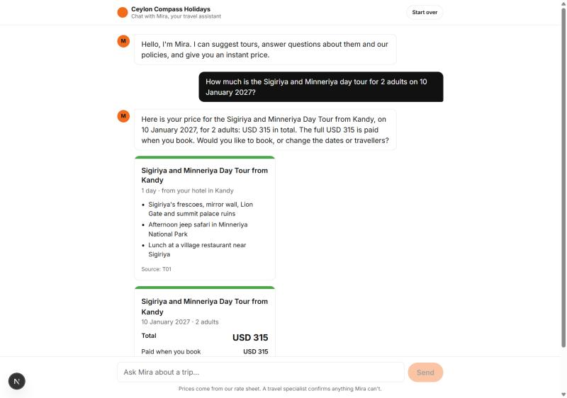

# Mira – AI Travel Booking Assistant

Conversational booking assistant for **Ceylon Compass Holidays**, a fictional Sri Lankan tour operator.

> Work in progress. Architecture, design decisions, evaluation, known limitations and AI tools used are documented before submission.

## Prerequisites

| Tool | Version | Used for |
|---|---|---|
| Docker Desktop (engine running) | 24+ | PostgreSQL and the Python backend |
| Node.js and npm | Node 20+ | The Next.js frontend |
| Git | any | |

You also need the supplied dataset folder `ceylon-compass-dataset` **next to this repo** (`../ceylon-compass-dataset`). To keep it elsewhere, set `MIRA_DATASET_HOST_DIR` to its path. It is mounted **read-only**; the app never changes it.

You don't need Python on your machine: the backend runs in Docker.

## Setup

**1. Environment file.** Copy the example, then open `.env` and fill in `GEMINI_API_KEY` (from Google AI Studio; used for search, and for chat if no DeepSeek key is set) and, to chat with DeepSeek, `DEEPSEEK_API_KEY`. The Langfuse keys are optional. `.env` is git-ignored; never commit it.

```powershell
Copy-Item .env.example .env
```

(macOS/Linux: `cp .env.example .env`)

**2. Database and backend.** This starts PostgreSQL on host port **5433** and the API on <http://localhost:8000>, with live reload.

```powershell
docker compose up -d --build
```

After editing `.env`, restart the backend so it reads the new values: `docker compose up -d backend`.

**3. Frontend.** This starts on <http://localhost:3010> (a fixed port, so it never clashes with other apps on 3000). The backend allows this origin through `FRONTEND_ORIGIN`; if you change the port, change both. The API address can be set with `NEXT_PUBLIC_API_URL` (default `http://localhost:8000/api/v1`).

```powershell
cd frontend
npm install
npm run dev
```

## Check that it works

Open <http://localhost:8000/api/v1/health>. The API docs are at <http://localhost:8000/docs>.

| Field | Expected | Meaning |
|---|---|---|
| `status` | `ok` | The API is up |
| `today` | `2026-11-19` | The date used for quoting (`MIRA_TODAY`, configurable) |
| `dataset_found` | `true` | The dataset folder is mounted |
| `database` | `ok` | PostgreSQL answers |
| `tracing` | `enabled` / `disabled` | Langfuse keys set or not (optional) |
| `llm_configured` | `true` | the chat provider's key is set |
| `llm_provider` | `deepseek` | which model runs the chat (`deepseek`, `gemini` or `ollama`) |

## Tests

```powershell
docker compose exec backend python -m pytest
```

Tests that call the Gemini chat model are marked `live` and skipped by default. Run them by hand (needs `GEMINI_API_KEY`):

```powershell
docker compose exec backend python -m pytest -m live
```

## Evaluation

The eval cases are the 17 starters (read from the dataset, unchanged) plus our own in `evaluation/test_cases/custom.jsonl`. The runner sends each case through the real graph and Gemini, in a fresh conversation, with `MIRA_TODAY=2026-11-19`:

```powershell
docker compose exec -w / backend python -m evaluation.runner
```

Add `--case S02` (repeatable), `--category pricing` or `--requirement R6` to run fewer cases. Add `--baseline` to also save `reports/baseline_<date>.md`.

Each case is checked by code (`evaluation/assertions.py`):
- the exact price and deposit, re-checked against the pricing engine;
- no currency amount that isn't in a verified quote;
- no price, and a saved staff flag, when a rate is missing or expired;
- valid UI payloads;
- no draft documents retrieved;
- the expected sources cited;
- no cost, margin or GP% shown;
- at most 3 questions.

The report goes to `evaluation/reports/evaluation_report.md`. It shows targets vs actual, the pass rate per requirement and per check, and dataset integrity. Each failing case is listed with its replies and Langfuse trace links. Quotes and enquiries from a run are saved under a fixed "eval" visitor.

## Project layout

```
backend/            FastAPI app (Python 3.12, pip), runs in Docker
  app/main.py       entry point: app, CORS, routers
  app/api/          HTTP routes (/api/v1/...)
  app/core/         settings (all configuration comes from env / .env)
  app/data_loader/  reads the dataset (read-only) and logs its data issues
  app/pricing/      deterministic pricing engine: calculate_quote(), CLI python -m app.pricing
  app/db/           tables, sessions, seed, repo (only what Mira creates is stored)
  app/rag/          content retrieval: chunker, Gemini embeddings, FAISS + BM25, retriever
  app/llm/          chat client (DeepSeek, Gemini or a local Ollama model), structured output, router and extraction tasks
  app/guards/       input and output guards (injection, personal data, invented prices)
  app/graph/        LangGraph workflow: state, nodes, tours, prompts, tracing, CLI
  var/index/        saved FAISS index and query-vector cache (git-ignored, rebuilt on change)
  media/ella/       our own Ella illustrations (the dataset has no photos)
  tests/            unit/, api/, db/, rag/ and live/ tests (db/ needs the db container; rag/ needs GEMINI_API_KEY)
evaluation/         eval cases (custom.jsonl); the runner comes later
frontend/           Next.js 15 + TypeScript + Tailwind v4 (chat UI on port 3010)
  scripts/sync-brand.mjs  brand tokens generated from the dataset's brand_pack.json (npm run brand)
  scripts/check-catalog.mjs  checks the Zod catalog against the backend's JSON Schema (npm run check:catalog)
  src/lib/          brand.ts (generated), api.ts (backend client), catalog-schema.ts (Zod),
                    catalog.schema.json (exported by the backend)
  src/components/   Header, chat/ (Chat, Messages, Composer), catalog/ (the generative UI components)
docker-compose.yml  db (PostgreSQL 16) + backend
.env.example        every setting, with placeholders only
```

## Configuration

All settings are environment variables; see `.env.example` for the full list. The important ones:

- `MIRA_TODAY`: "today" for quotes and date checks. Defaults to `2026-11-19`, the date the evaluation cases assume.
- `LLM_PROVIDER` / `DEEPSEEK_API_KEY`: which model runs the chat. With the default `auto`, Mira uses DeepSeek (`deepseek-chat`, OpenAI-compatible API) when `DEEPSEEK_API_KEY` is set, and Gemini otherwise. DeepSeek has no JSON-schema mode, so structured answers use function calling; its calls get longer timeouts (20 s, 30 s for the strong role) and a 50 s budget. Search embeddings always use Gemini, because DeepSeek has no embedding API, so `GEMINI_API_KEY` is still needed. `GET /api/v1/health` shows the provider in use.
- `LLM_PROVIDER=ollama`: runs the chat on a local model through Ollama, with no API key and nothing sent to a cloud LLM (search embeddings still use Gemini). Start Ollama on the host and run `ollama pull qwen3:4b`; the backend container reaches it at `host.docker.internal:11434` (set in `docker-compose.yml`, change with `OLLAMA_BASE_URL`). The default model is `qwen3:4b`, small enough for a 4 GB GPU, with "thinking" turned off. Output follows the JSON schema, each call may take up to 50 s, and if Ollama is stopped or too slow the turn gets the rule-based fallback. A small local model is slower and less accurate than Gemini or DeepSeek, so it is an option, not the default.
- `GEMINI_MODEL_FAST` / `GEMINI_MODEL_STRONG`: Gemini chat models (when Gemini is the provider). The defaults are `gemini-3.1-flash-lite` / `gemini-3.5-flash`, because Gemini 2.5 models are no longer available to new API keys.
- `GEMINI_MODEL_BACKUP`: a quick model, tried second when the first is overloaded (503), stuck (timeout or 504) or out of quota (429). The default is `gemini-3.5-flash-lite`.
  - **Order:** the requested model, then the backup, then the other main model.
  - **Overloaded:** retry the same model once, then switch.
  - **Timeout or quota:** switch at once.
  - **Timeouts:** each call times out after 10 s (15 s for the strong model). That's Gemini's minimum allowed deadline, so one stuck call can't use up the 25 s turn budget.
  - **Rest:** a failing model is skipped for 30–60 s.
  - **Everything down:** Mira still replies with fixed wording or a handoff.
- `MIRA_MARGIN_DAY` / `MIRA_MARGIN_MULTIDAY`: optional margin overrides. If they're empty, the rate workbook's values are used.
- `MIRA_STAFF_EMAIL` / `MIRA_STAFF_PASSWORD` and `MIRA_APPROVER_EMAIL` / `MIRA_APPROVER_PASSWORD`: the two demo staff accounts. They're created at startup (or with `python -m app.db.seed`) only if a password is set, stored hashed, and never overwritten afterwards.

## Database

Tables are created at startup if missing (10 tables: visitors, conversations, quotes, enquiries, bookings, users, staff_sessions, enquiry_notes, content_items, media), and the demo users and media are seeded. Both steps are safe to repeat. Tours, content and rates are never stored in the database: they're read from the dataset.

## API

All routes are under `/api/v1`; try them at <http://localhost:8000/docs>.

| Route | What it does |
|---|---|
| `POST /chat` | One traveller turn: `{message, conversation_id?, visitor_id?}` → reply, UI components, sources, `quote_id`. Send the `conversation_id` back to continue. |
| `POST /chat/stream` | The same turn as an AG-UI-style event stream (Server-Sent Events), used by the chat UI |
| `GET /conversations/{id}` | The messages so far |
| `GET /quotes/{id}` | A saved quote, public fields only (never cost or margin) |
| `POST /quotes` | A direct quote from a form, through the same pricing engine |
| `POST /enquiries` | "Send to the team" with optional contact details |
| `GET /tours/{id}` | A published tour (drafts are 404); prices in the text are masked |
| `POST /bookings` | Mock booking: re-checks the price, then charges the deposit with the mock provider |
| `GET /health` | Status of the dataset, database, index, tracing and LLM |
| `POST /auth/login`, `POST /auth/logout`, `GET /auth/me` | Staff sign-in with a session cookie |
| `GET /staff/enquiries` | Staff only: enquiries, flagged first; filter by `status` or `flagged` |
| `GET /staff/enquiries/{id}` | Staff only: party, tour, price, deposit, **cost, GP%**, cost lines, flags, trace link, chat, notes |
| `POST /staff/enquiries/{id}/notes` | Staff only: add a note (notes can never be edited or deleted) |
| `PATCH /staff/enquiries/{id}/status` | Staff only: `new`, `contacted`, `pending`, `confirmed` or `closed` (each change is also noted) |

Every quote is saved with its public and staff fields and the Langfuse `trace_id`, plus a private enquiry for staff (`no_price` with reason flags when a specialist must confirm).

**Mock payments.** The card `4242 4242 4242 4242` succeeds and `4000 0000 0000 0002` is declined. `MOCK_PAYMENT_FAIL=1` makes every charge fail. A failure returns a friendly message with next steps and saves a `booking_failed` enquiry. Card numbers are never stored or logged.

**Staff console** (<http://localhost:3010/staff>). Sign in with a demo account from `.env`. It is separate from the traveller chat: its own pages, header and layout, and it is hidden from search engines.

- **Sessions.** The browser gets a random token in an HttpOnly, SameSite=Lax cookie that lasts 8 hours (`MIRA_SESSION_HOURS`). The database stores only the token's SHA-256, and signing out deletes it. Set `MIRA_COOKIE_SECURE=1` when serving over HTTPS.
- **Sign-in protection.** A wrong password and an unknown email get the same answer and take the same time. After 5 failures in 15 minutes, sign-in is refused for a while.
- **Roles.** Roles are checked in code by `require_role()`: no session gets 401, and the wrong role gets 403. Approvers can use everything staff can.
- **Private data.** Cost, margin, GP% and contact details appear only in `/staff` responses. Tests check every other route.
- **Notes.** Notes are append-only, and a database trigger refuses any UPDATE or DELETE on them.
- **Trace links.** The link to Langfuse uses `LANGFUSE_PROJECT_ID` if it is set; otherwise the project is looked up once.

**Errors** always look like `{"error": "not_found", "message": "..."}`, with no stack traces. Logs mask emails, phone numbers and card numbers.

## Conversation graph

Each chat turn runs through a LangGraph `StateGraph` (`backend/app/graph/`). Gemini only classifies (guard), extracts trip details (discovery) and words the reply (respond). Code decides the route, prices with the pricing engine, picks tours and checks every reply with the output guard. Conversation state is kept per thread by a Postgres checkpointer (`langgraph-checkpoint-postgres`), so Mira remembers the trip details of the current chat even after a backend restart; each reply's cards are saved with it, so reloading the page shows the chat as it was. "New chat" in the header starts a new conversation (a returning visitor still gets the "welcome back" with their last trip).


(Generated with `python -m app.graph.build`, labels added.)

Chat in the terminal:

```powershell
docker compose exec backend python -m app.graph.cli --debug
```

Scripted turns: `python -m app.graph.cli --say "Hi" --say "2 adults from 3 May 2027"`.

**Tracing.** With the Langfuse keys set, each turn is one trace, grouped by conversation as a session. It holds a span for every node and every Gemini call, plus the prompt version. Emails, phone numbers and card-like numbers are masked before anything is sent to Langfuse, and before the model sees the message. If Langfuse is unreachable or a key is wrong, chat keeps working without traces.

## Generative UI

Mira's replies can carry UI components, but only from a fixed catalog of eight: `traveller_picker`, `tour_card`, `itinerary_day`, `price_breakdown`, `booking_form`, `specialist_notice`, `source_list` and `welcome_back` (`backend/app/ui/catalog.py`).

- **Code chooses, not the LLM.** The `build_ui` node picks components from the verified state (`app/ui/build.py`): a saved quote gives a tour card, a price card and a booking form; a refusal or an unanswered question gives a specialist notice; suggested tours give tour cards plus the top tour's day-by-day plan; a question about who is travelling gives the traveller picker.
- **Prices never travel in a component.** `price_breakdown` and `booking_form` carry only a `quote_id`. The browser fetches the verified public quote from `GET /quotes/{id}`.
- **Validated twice.** The server checks every payload against a Pydantic discriminated union with `extra="forbid"` (`app/guards/ui_validator.py`). It drops unknown types, bad or extra props, markup or script in text, money amounts in text, and price components that don't point at this turn's saved quote. Drops are logged and recorded in the trace (`ui_rejected`). The browser checks again with Zod (`frontend/src/lib/catalog-schema.ts`), and the registry renders only known types. Each component has an error boundary.
- **One contract.** `python -m app.ui.export` writes the catalog's JSON Schema to `frontend/src/lib/catalog.schema.json`. A backend test fails if that file is stale, and `npm run check:catalog` fails if the Zod schemas drift from it.
- **Booking and enquiry forms** post straight to `/bookings` and `/enquiries`. Contact details and card numbers never pass through the chat, the LLM or the traces.

**Screenshots** (`docs/screenshots/`, taken at 1280 px and 375 px):

| | Desktop (1280 px) | Phone (375 px) |
|---|---|---|
| Instant quote: tour card, price card (fetched by quote ID), booking form |  |  |
| No price (S04): specialist notice, enquiry sent |  |  |
| Policy answer with source chips |  |  |
| Planner: suggested tour cards and day-by-day plan |  | |

**Decision: AG-UI-style SSE instead of CopilotKit (step 11.1).** CopilotKit would need its own Node runtime between the browser and our Python graph, plus an adapter for our LangGraph state. With the submission deadline close, we used the plan's fallback instead: `POST /chat/stream` sends AG-UI event types over Server-Sent Events:

1. `RUN_STARTED`
2. `STEP_FINISHED` for each graph node, which drives the "what Mira is doing" status line
3. `TEXT_MESSAGE_START`, `TEXT_MESSAGE_CONTENT` and `TEXT_MESSAGE_END`
4. one `CUSTOM` `ui_component` event per validated component
5. `RUN_FINISHED`, carrying the full response, or `RUN_ERROR`

The frontend reads the stream with `fetch`, so there is no extra dependency. The text arrives as one block, because the reply is generated as structured output and then checked by the output guard before anyone sees it.

## Why the backend runs in Docker

The backend's dependencies are installed with **pip** inside a Linux container (`backend/Dockerfile`). This keeps native packages (FAISS, SQLAlchemy, psycopg) working the same on every machine, including Windows machines where Smart App Control blocks unsigned Python extension DLLs.
